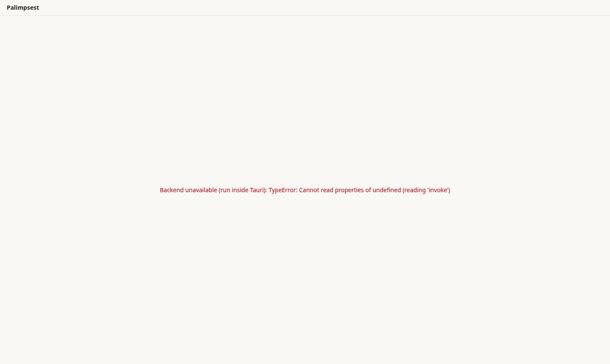
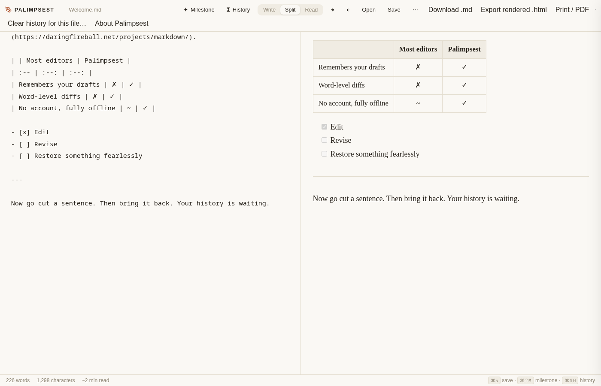
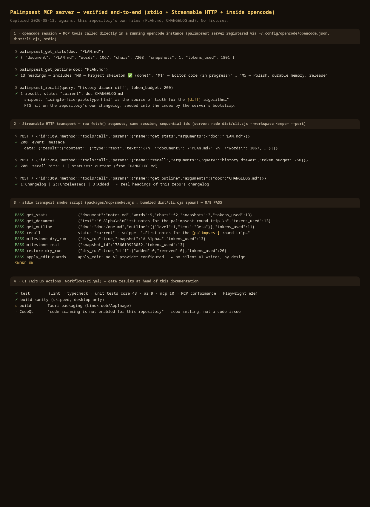
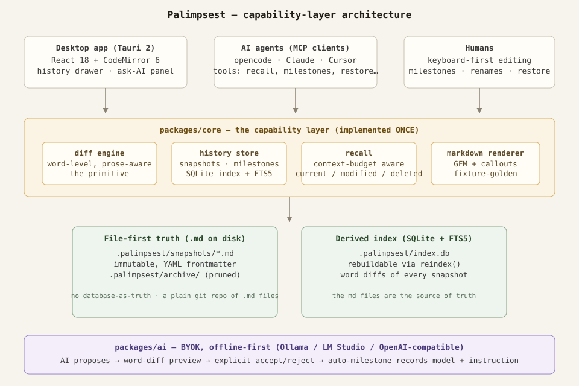

# Palimpsest

> The Markdown editor with a memory. Word-level time travel for prose, with AI that proposes instead of rewrites — and an MCP spine so agents get the same guarantees humans get.

[](https://github.com/touhidsiddiqueeraj-bit/palimpsest/actions/workflows/ci.yml)
[](docs/VERIFICATION.md)
[](LICENSE)
[](https://github.com/touhidsiddiqueeraj-bit/palimpsest/releases)

Every serious creative tool treats history as a first-class citizen. Markdown
editors don't — line-based diffs (Git) are wrong for prose, because a
rewrapped paragraph reads as a total rewrite. Palimpsest fixes that with
**word-level time travel**: automatic snapshots, named milestones, and
prose-aware diffs. AI is woven into the same wedge: AI edits arrive as
reviewable word diffs, never silent rewrites.

**Nothing leaves your device.** Text, history, and API keys stay local —
keys live in your OS keychain, and AI features work with your own keys or a
local model (Ollama / LM Studio / polaris studio) with zero network calls.
No account. No telemetry. Ever.

## Gallery

| The editor (desktop app, running in a browser via Vite)                                    | The v0 prototype (diff algorithm source of truth)                            | Live MCP verification transcript                                                                   |
| ------------------------------------------------------------------------------------------ | ---------------------------------------------------------------------------- | -------------------------------------------------------------------------------------------------- |
|  |  |  |

Docs: [Architecture](docs/ARCHITECTURE.md) · [Verification / proof](docs/VERIFICATION.md) · [ADR index](docs/adr) · [Master spec](docs/PALIMPSEST_MASTER_PROMPT.md)

## Architecture at a glance



Document and history operations are implemented **once** in
`packages/core` as a typed capability API. The desktop UI, the chat
tool-caller, and the MCP server all consume that **same** API — no logic is
duplicated at any boundary. `packages/ai` stays BYOK and offline-first;
`packages/mcp` exposes the spine to agents; snapshots are plain `.md`
files (the source of truth) with SQLite/FTS5 as a rebuildable index.

## Features

- **Word-level time travel** — automatic snapshots when you pause, named
  milestones, prose-aware diffs (rewrapping a paragraph changes zero words).
- **History drawer** — timeline, per-snapshot "View changes", restore
  anything fearlessly (restores are themselves snapshotted).
- **AI proposes, the diff decides** — inline edits, autocomplete, critique
  and chat; every AI edit is previewed as a word diff with explicit
  accept/reject, and accepting records the model + instruction as an
  auto-milestone.
- **BYOK provider registry** — OpenAI-compatible endpoints, Ollama, LM
  Studio; keys stay in the OS keychain.
- **MCP server (stdio + Streamable HTTP)** — AI agents reach every core
  action through the capability layer: `recall`, `get_document`,
  `get_outline`, `get_stats`, `create_milestone`, `restore_version`,
  `apply_edit`. Every read carries `tokens_used`; every mutator accepts a
  `dry_run`.
- **MCP client** — call external MCP tools behind per-tool allowlists and a
  write-through audit log.
- **Modes** — fiction, technical docs, notes, blogging, journaling, academic:
  templates, snippets, AI prompts, lint hints, export defaults per context.
- **Export** — Markdown, standalone HTML, Print → PDF, multi-file compile.
- **Network transparency** — every outbound request lights a destination
  indicator; a hard **Local-only** toggle blocks everything non-localhost.
- Editor with the touches that matter: Write/Split/Read, typewriter scroll,
  zen mode, focus mode, command palette, themes, welcome document.

## Quick start (developers)

```bash
pnpm install
pnpm test && pnpm typecheck && pnpm lint   # all gates
pnpm tauri dev                             # run the desktop app
```

See [CONTRIBUTING.md](CONTRIBUTING.md) for the full dev setup, and
[AGENTS.md](AGENTS.md) for the product laws and repo map.

## Install

Download the installer for your platform from the
[latest release](https://github.com/touhidsiddiqueeraj-bit/palimpsest/releases).

## MCP setup — for AI agents

Palimpsest ships a runnable MCP server. Use the bundled CLI on any
workspace of `.md` files:

```jsonc
// Claude Desktop / compatible MCP client
{
  "mcpServers": {
    "palimpsest": {
      "command": "node",
      "args": ["/path/to/palimpsest/packages/mcp/dist/cli.cjs", "--workspace", "/path/to/your/notes"]
    }
  }
}
// opencode (global config ~/.config/opencode/opencode.json)
{
  "mcp": {
    "palimpsest": {
      "type": "local",
      "command": ["node", "/path/to/palimpsest/packages/mcp/dist/cli.cjs", "--workspace", "/path/to/your/notes"],
      "enabled": true
    }
  }
}
```

The server boots by indexing the workspace: every `.md` file gets a first
snapshot (the file itself stays the source of truth — `.palimpsest/` lives
alongside it, and a bare git repo of plain `.md` files remains fully
readable). No AI provider is required for history features. `apply_edit`
needs a local provider while local-only is on (default); with local-only off
(`PALIMPSEST_LOCAL_ONLY=0`) it runs against any configured provider, or
applies agent-supplied `content` directly — every edit is captured as a
before-snapshot plus a milestone, never a silent write.

Install the CLI on your PATH (Node 22+, rebuild-safe via `prepare`):
`cd packages/mcp && pnpm link --global` — then `palimpsest --help`.

## BYOK setup

1. Open **Settings → AI Providers**.
2. Add your provider and paste your API key — it goes straight into your OS
   keychain, never into a database or log file.
3. Prefer local? Point any OpenAI-compatible provider at your local endpoint
   (e.g. `http://localhost:11434/v1` for Ollama) and enable **Offline Mode**.

## Privacy statement

Palimpsest is local-first by default. Your text, your history, and your API
keys never leave your device except via an explicit, visible action you
trigger: saving, exporting, or an AI request. There is no telemetry, no
analytics, and no phone-home — by design and by code review gate.

## Roadmap

- **v0.1** — word-level history, milestones, prose-aware diffs, MCP server
- **v0.2** — AI layer: BYOK registry, inline edit, autocomplete, chat
- **v0.3** — Modes, multi-file compile export, MCP client
- Later — plugin JS runtime (architecture leaves room), academic export
  (Pandoc detection)

## License — non-commercial use

[PolyForm Noncommercial 1.0.0](LICENSE) — free for personal study, hobby
projects, research, education, and noncommercial organizations; commercial
use requires a separate license. See the full text in [LICENSE](LICENSE).
